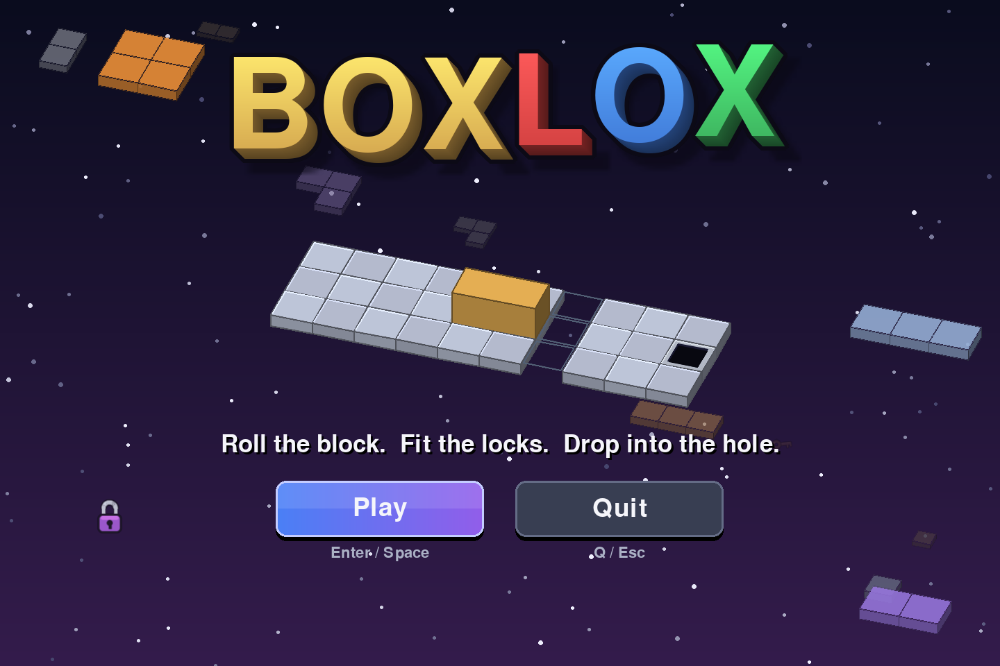
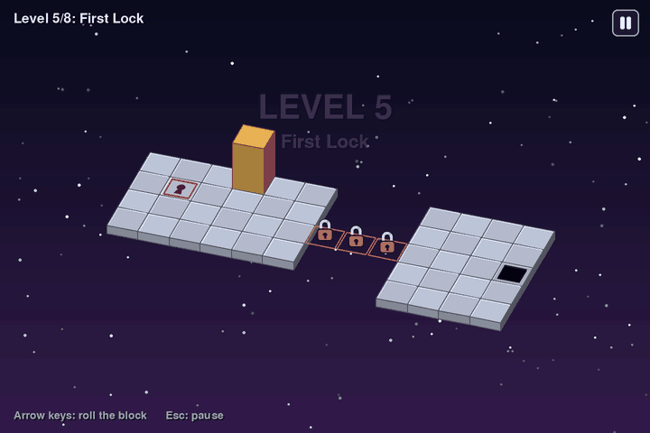
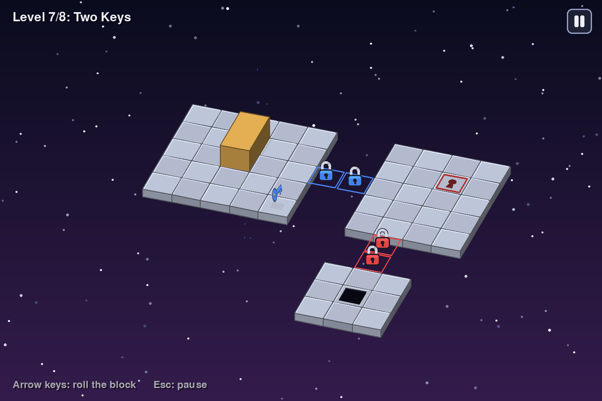
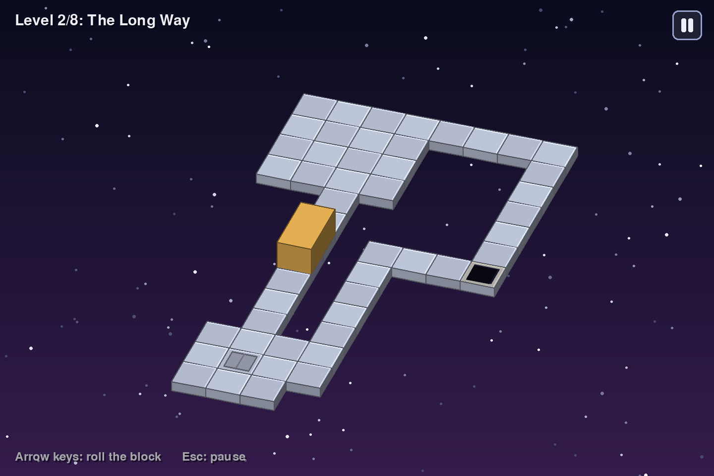

<div align="center">



# BOXLOX

**Roll the block. Fit the locks. Drop into the hole.**

A pseudo-3D block-rolling puzzle game written in Python and Pygame. Every pixel is drawn in code, with no image files.


</div>

---

## About

You steer a tall 1×1×2 block across tiles floating in space. Each roll tips it over, so it alternates between **standing** on one tile and **lying** across two. Let any part of it hang over the edge and it falls. Finish a level by dropping the block, standing upright, into the goal hole.

BOXLOX is inspired by the classic Flash game *Bloxorz*, and adds its own twist: **pose locks**.

<div align="center">

<br><sub>Level 5, start to finish: rest on the lock in the right pose → the key appears → collect it → the gates open → drop into the goal.</sub>
</div>

## The twist: pose locks

A lock only opens if the block lands on it in **exactly** the right pose:

| Lock shape | Pose it needs |
|---|---|
| 1-tile patch | standing up |
| 2-tile patch, left–right | lying left–right across both tiles |
| 2-tile patch, front–back | lying front–back across both tiles |

1. Solving a lock releases the **key** of the same colour.
2. Touching the key collects it.
3. Collecting a key opens every **gate** of that colour.

With several colours in one level, the puzzle becomes working out the order and the approach. To land in the right pose, you often have to set the block up several moves earlier.

<div align="center">

<br><sub>Level 7, "Two Keys": the blue lock is solved and its key has appeared. The red lock still needs the block standing on it.</sub>
</div>

## Features

- **8 handmade levels**, every one proven solvable by the built-in solver.
- **Classic tiles:** fragile tiles that break under a standing block, soft and heavy switches, and bridges.
- **Pose locks, keys and gates** in five colours.
- **A hidden trap tile.** Some levels hide something that looks like plain floor (see the spoiler below).
- **Smooth animation:** the block really rolls about its edge, and it tumbles off edges and sinks into the goal. There are particles, screen shake and confetti.
- **Animated title screen:** a demo block solves a tiny puzzle in a loop, over a parallax background.
- **Sharp at any size:** the window is high-DPI aware and everything is anti-aliased.
- **Pause menu,** plus GAME OVER and YOU WIN! screens.

<details>
<summary><b>Spoiler: the mystery tile</b></summary>
<br>

Some levels hide a **spin tile** that looks exactly like ordinary floor. The first time the block lands on it:

- the whole view turns 90° (the arrow keys still match the screen);
- the goal you were heading for is **sealed with a hatch**;
- a **new goal opens** somewhere that was plain floor a moment ago.

It works once per attempt, and restarting hides it again. The obvious route always triggers it, and there's exactly one way round it.

<div align="center">

</div>

</details>

## Getting started

You need **Python 3** and **Pygame 2**.

```bash
git clone https://github.com/AbhishekBartake/Boxlox.git
cd Boxlox
python -m pip install -r requirements.txt
python main.py
```

No git? Click **Code → Download ZIP** on this page, unzip it, and run the last two commands inside the unzipped folder.

(Use `python3` if `python` isn't found on macOS or Linux.)

### Controls

| Key | Action |
|---|---|
| ← ↑ → ↓ | Roll the block (always matches the screen) |
| Esc / P / ❚❚ button | Pause: Resume or Quit |
| Enter | Main button on any menu |
| R | Restart after GAME OVER |
| Q | Quit from any menu |

## Under the hood

The game uses only the Python standard library and Pygame.

### Recursive solver

`boxlox/solver.py` runs a **recursive depth-first search** over complete game states: the block's position and pose, plus which bridges are up, which locks are solved, which keys are held, and whether the trap has gone off.

It prunes any state it has already reached in fewer moves, and any branch that can't beat the best solution found so far. That makes it return the **shortest** solution.

```text
$ python check_levels.py
Level 1 'Narrow Ledge': solvable in 10 moves (RRRRDDRRDD) [0.01s]
Level 2 'The Long Way': solvable in 21 moves (LURRRRRRRRDLURULLLLUU) [0.04s]
Level 3 'Thin Ice': solvable in 21 moves (ULDRRRRRRRRRDLURDDDDD) [0.00s]
Level 4 'Bridge Builder': solvable in 15 moves (URURDRRRDLURRRR) [0.13s]
Level 5 'First Lock': solvable in 21 moves (DRULDLRRDLURDRRRURRRD) [0.36s]
Level 6 'Lie Down': solvable in 24 moves (DRURDDDDRULDRUURRRRDLURD) [0.15s]
Level 7 'Two Keys': solvable in 28 moves (DRRLDRURDLURRRURLDRULDDLRDDD) [1.04s]
Level 8 'Grand Lock': solvable in 40 moves (RULDDRUURRRRURDLLDRURDURRRDRULUDDLDRDDDD) [4.27s]
```

### Rendering

There are no sprites or 3D libraries.

- Every tile and the block are boxes projected with `screen = origin + x·X + y·Y − z·UNIT`.
- Faces are sorted back to front (painter's algorithm), culled when they face away, and shaded by how much they face a light.
- The roll animation rotates the block's 8 corners about the edge it is tipping over.
- The spin trap rotates the whole projection about the centre of the board.
- Edges are smoothed with `pygame.gfxdraw`.
- On Windows, the window opts into high-DPI mode, so it renders at full resolution instead of being blurred by display scaling.

### Code layout

```
main.py             entry point: window + game loop
check_levels.py     solves every level and prints the results
levels/             one plain-text file per level
boxlox/
  block.py          Block: position + pose, roll(), cells()
  board.py          Board: tiles, switches, locks, keys, gates, and the rules for one move
  level_loader.py   parses level files, with line-numbered error messages
  solver.py         recursive shortest-solution search
  game.py           Game: state machine (title, playing, rolling, falling, …), input, animation
  renderer.py       pseudo-3D drawing
  overlay.py        title, PAUSED, GAME OVER, YOU WIN! screens and buttons
  title_scene.py    animated title background and demo
  effects.py        particles and screen shake
  icons.py          padlock and key icons
  display.py        window sizing and high-DPI scaling
```

## Make your own level

Levels are plain text files in `levels/`, loaded in filename order. Drop in `09.txt` and it becomes level 9, with no code changes.

```
name: First Lock
start: 1 1
grid:
 ........
 ..S..b..
 .o...b..
 ....K..#G
links:
lock 3 1 red
key 5 3 red
gate 8 3 red
switch 2 2 bridge 6 1 6 2
```

| Symbol | Tile | Symbol | Tile |
|---|---|---|---|
| `.` | floor | `S` | lock: standing |
| *space* | empty | `=` | lock: lying left–right (2 cells) |
| `G` | goal | `H` | lock: lying front–back (2 cells) |
| `F` | fragile | `K` | key |
| `o` | soft switch (any touch) | `#` | gate |
| `X` | heavy switch (standing only) | `@` | hidden spin tile |
| `b` / `B` | bridge (starts down / up) | `g` | hidden second goal (needs `@`) |

- Coordinates are `x y`, counted from 0 at the top-left.
- Under `links:`, give locks, keys and gates a colour (`red`, `blue`, `green`, `yellow`, `purple`), and list the bridge cells each switch toggles.
- Run `python check_levels.py` to check your level is solvable. A mistake in the file gives a clear error such as `levels/09.txt, line 14: unknown colour 'pink'`.

## Background

BOXLOX was built in October 2026 as the final project for **COMP9001 (Introduction to Programming)** at the University of Sydney. It shows three advanced topics:

- **object-oriented design;**
- **file input/output** (the level files);
- **recursion** (the solver).

## Credits

- Made by Abhishek Bartake.
- Inspired by **Bloxorz** by Damien Clarke (Coolmath Games). All code, levels and graphics here are original.
- Built with [Pygame](https://www.pygame.org/).
